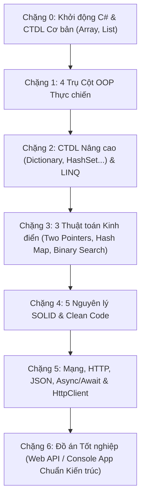

# BẢN CAM KẾT & QUY TẮC HUẤN LUYỆN C# THỰC CHIẾN (FROM ZERO TO HERO)

> **Mục tiêu**: Đưa học viên từ con số 0 / mất gốc trở thành lập trình viên C# có nền tảng vững vàng, tư duy mạch lạc và phản xạ tự nhiên với **OOP, SOLID, Cấu trúc Dữ liệu, LINQ, 3 Thuật toán cốt lõi, và Giao thức Mạng / HTTP**.  
> **Cường độ học tập**: 3 – 4 giờ / ngày (Liên tục trong 6 tuần ~ 40 - 42 ngày).

---

## I. QUY TẮC CỐT LÕI CỦA COACH (AI MENTOR)

Để đảm bảo hiệu quả cao nhất và không làm bạn lãng phí thời gian, Coach cam kết tuân thủ 5 nguyên tắc sư phạm sau:

1. **Nguyên tắc "Đời thực trước, Code sau"**:
   * Không bao giờ giải thích bằng thuật ngữ học thuật khô khan, khó hiểu.
   * Mọi khái niệm trừu tượng (như Polymorphism, Interface, Dependency Inversion, Hash Collision) đều phải được mô tả bằng hình ảnh thực tế (ổ cắm điện, menu nhà hàng, chìa khóa vạn năng, xe cộ...).

2. **Nguyên tắc "Bàn tay trên phím" (Hands-on First)**:
   * 30% lý thuyết bản chất – 70% thời gian thực hành.
   * Không đưa ra những đoạn code dài hàng trăm dòng bắt học viên đọc hiểu. Mọi bài học đều chia nhỏ thành các "viên gạch", học viên tự tay gõ và chứng kiến code chạy.

3. **Nguyên tắc Code Review Nghiêm Khắc**:
   * Khi học viên gửi code, Coach sẽ soi kỹ:
     * **Tính đúng đắn (Correctness)**: Code có chạy đúng mọi trường hợp biên (edge cases) không?
     * **Quy ước chuẩn C# (Naming Conventions & Clean Code)**: Biến đặt tên đúng `camelCase`, hàm và class chuẩn `PascalCase`, không đặt tên kiểu `x`, `y`, `temp` vô nghĩa.
     * **Hiệu năng & Rủi ro**: Có bị tràn bộ nhớ, rò rỉ kết nối, hay lỗi NullReferenceException tiềm ẩn không?

4. **Nguyên tắc "Không mớm mồi - Ép tư duy"**:
   * Khi gặp lỗi (bug), Coach sẽ **không sửa hộ ngay lập tức**.
   * Coach sẽ hướng dẫn cách đọc thông báo lỗi của C#, đặt câu hỏi gợi mở để học viên tự tìm ra nguyên nhân và tự tay sửa. Đây là kỹ năng sinh tồn quan trọng nhất của lập trình viên.

5. **Nguyên tắc Kiểm tra Phản xạ Mỗi Chặng**:
   * Cuối mỗi chặng luôn có một bài toán tổng hợp hoặc buổi phỏng vấn giả lập để kiểm tra: "Nếu nhìn vào đề bài mới toanh, học viên có tự biết chọn đúng Class, đúng Interface, đúng CTDL và LINQ hay không?".

---

## II. QUY TẮC KỶ LUẬT CỦA HỌC VIÊN

1. **100% Tự Gõ Bằng Tay**:
   * Tuyệt đối không copy-paste code mẫu. Phải tự tay gõ từng dòng vào IDE để ngón tay và não bộ hình thành phản xạ cơ bắp.
2. **Kỷ luật Thời gian (Deep Work 3-4h/ngày)**:
   * Tắt mạng xã hội, tập trung hoàn toàn vào việc học và làm bài tập.
3. **Không Giấu Dốt**:
   * Nếu chưa hiểu rõ tại sao dòng code đó lại chạy như vậy, phải yêu cầu Coach giải thích lại đến khi thực sự "thông suốt" mới đi tiếp.

---

## III. NỘI DUNG 6 CHẶNG HUẤN LUYỆN CHI TIẾT

### 🔹 Chặng 0: Lấy lại gốc C# & Cấu trúc Dữ liệu cơ bản (Tuần 1 - Nửa đầu)
* **Mục tiêu**: Xóa tan nỗi sợ cú pháp, làm chủ luồng điều khiển của máy tính.
* **Kiến thức**:
  * Kiểu dữ liệu nguyên thủy: `int`, `double`, `decimal`, `string`, `bool`. Bộ nhớ Stack vs Heap cơ bản.
  * Ép kiểu (Casting & Parsing): `int.Parse()`, `Convert`, `(int)x`.
  * Câu lệnh rẽ nhánh: `if - else if - else`, `switch - case` (và switch expression hiện đại).
  * Vòng lặp: `for`, `while`, `foreach`.
  * **CTDL Cơ bản**: Mảng 1 chiều (`Array`) và Danh sách động (`List<T>`). Phân biệt kích thước cố định vs co giãn linh hoạt.
  * Hàm (Method): Tham số, kiểu trả về, từ khóa `ref`, `out`, `in`.

### 🔹 Chặng 1: Làm chủ 4 Trụ Cột OOP (Tuần 1 Nửa sau - Tuần 2)
* **Mục tiêu**: Tư duy hướng đối tượng - biến thế giới thực thành các Class trong code.
* **Kiến thức**:
  * **Class & Object**: Khái niệm bản thiết kế vs ngôi nhà thực tế. Từ khóa `new`, `this`.
  * **Constructor (Hàm khởi tạo)**: Khởi tạo giá trị hợp lệ, nạp chồng constructor.
  * **Encapsulation (Đóng gói)**: Access modifiers (`private`, `public`, `protected`), Properties `{ get; set; }`, validation dữ liệu.
  * **Inheritance (Kế thừa)**: Tái sử dụng code qua quan hệ "IS-A", từ khóa `base`.
  * **Polymorphism (Đa hình)**: Nạp chồng (`Overloading`) và Ghi đè (`Overriding` với `virtual`, `override`).
  * **Abstraction (Trừu tượng)**: `abstract class` vs `interface`. Hiểu sâu tại sao Interface là xương sống của toàn bộ hệ sinh thái .NET hiện đại.

### 🔹 Chặng 2: Cấu trúc Dữ liệu Nâng cao & Làm chủ LINQ (Tuần 3)
* **Mục tiêu**: Xử lý, biến đổi và truy vấn hàng nghìn dòng dữ liệu chỉ bằng 1-2 dòng code.
* **Kiến thức**:
  * **CTDL Nâng cao**:
    * `Dictionary<TKey, TValue>`: Bảng băm (Hash Table) - tra cứu tức thì $O(1)$.
    * `HashSet<T>`: Tập hợp phần tử duy nhất, loại bỏ trùng lặp siêu tốc.
    * `Queue<T>` (FIFO - Vào trước ra trước) & `Stack<T>` (LIFO - Vào sau ra trước).
  * **Delegate & Lambda Expression**: Hiểu bản chất cú pháp mũi tên `x => x > 5`.
  * **LINQ (Language Integrated Query)**:
    * Lọc: `.Where()`
    * Chiếu / Chuyển đổi: `.Select()`, `.SelectMany()`
    * Tìm kiếm: `.First()`, `.FirstOrDefault()`, `.Single()`, `.Any()`, `.All()`
    * Sắp xếp & Gom nhóm: `.OrderBy()`, `.OrderByDescending()`, `.GroupBy()`
    * Thống kê: `.Count()`, `.Sum()`, `.Average()`, `.Min()`, `.Max()`
    * Kết nối dữ liệu: `.Join()`

### 🔹 Chặng 3: 3 Thuật toán Cốt lõi & Đo độ phức tạp (Tuần 4)
* **Mục tiêu**: Rèn luyện tư duy logic phỏng vấn, biết cách tối ưu thời gian ($O(N)$) và không gian bộ nhớ.
* **Kiến thức**:
  * Hiểu khái niệm Big-O: So sánh $O(1)$, $O(N)$, $O(N^2)$, $O(\log N)$.
  * **Thuật toán 1: Kỹ thuật Two Pointers (2 con trỏ)**: Áp dụng đảo ngược mảng/chuỗi, kiểm tra chuỗi đối xứng (Palindrome), bài toán cặp số.
  * **Thuật toán 2: Kỹ thuật Hash Map (Dictionary)**: Đếm tần suất ký tự/từ ngữ, giải quyết bài toán kinh điển Two Sum trong $O(N)$ thay vì $O(N^2)$.
  * **Thuật toán 3: Binary Search (Tìm kiếm nhị phân)**: Tư duy chia để trị trên mảng đã sắp xếp với độ phức tạp $O(\log N)$.

### 🔹 Chặng 4: 5 Nguyên lý SOLID & Clean Code (Tuần 5)
* **Mục tiêu**: Nâng cấp từ "code chạy được" lên "code sạch, chuẩn doanh nghiệp, dễ bảo trì".
* **Kiến thức**:
  * **S (Single Responsibility Principle)**: Đơn trách nhiệm - 1 class chỉ làm 1 việc duy nhất.
  * **O (Open/Closed Principle)**: Mở cho mở rộng, đóng cho sửa đổi (dùng Interface/Abstract).
  * **L (Liskov Substitution Principle)**: Class con phải thay thế được class cha mà không làm gãy logic.
  * **I (Interface Segregation Principle)**: Chia nhỏ interface, không ép class phụ thuộc hàm nó không dùng.
  * **D (Dependency Inversion Principle)**: Module cấp cao không phụ thuộc module cấp thấp, cả 2 phụ thuộc vào trừu tượng (Interface).
  * Giới thiệu cơ chế **Dependency Injection (DI)** - chìa khóa vàng của ASP.NET Core.

### 🔹 Chặng 5: Mạng (HTTP), JSON & Bất đồng bộ (Tuần 6 Nửa đầu)
* **Mục tiêu**: Hiểu bản chất cách máy tính trao đổi dữ liệu qua Internet.
* **Kiến thức**:
  * **Giao thức HTTP**: Request & Response, Headers, Body, HTTP Methods (`GET`, `POST`, `PUT`, `DELETE`), Status Codes (`200`, `201`, `400`, `401`, `404`, `500`).
  * **JSON**: Serialization (Object $\rightarrow$ JSON) và Deserialization (JSON $\rightarrow$ Object) với `System.Text.Json`.
  * **Lập trình Bất đồng bộ (`async` / `await` & `Task`)**: Bản chất không khóa luồng chính (non-blocking thread).
  * **`HttpClient` trong C#**: Viết code gọi API thực tế trên internet, hứng dữ liệu JSON và parse ra C# Model.

### 🔹 Chặng 6: Đồ án Tốt nghiệp Tích hợp (Tuần 6 Nửa sau)
* **Đề tài**: Xây dựng Ứng dụng Quản lý & Đồng bộ Đơn hàng / Sản phẩm tích hợp đầy đủ:
  * Tổ chức mô hình hướng đối tượng (OOP).
  * Áp dụng đầy đủ 5 nguyên lý SOLID và Dependency Injection.
  * Lưu trữ và tra cứu nhanh bằng CTDL `Dictionary` / `HashSet`.
  * Lọc, báo cáo doanh thu, thống kê bằng LINQ.
  * Gọi HTTP API để lấy tỷ giá tiền tệ và cập nhật dữ liệu từ xa.

---

## IV. TIÊU CHUẨN ĐÁNH GIÁ "HOÀN THÀNH" (DEFINITION OF DONE)

Bạn chỉ được xem là "tốt nghiệp" một chặng khi:
1. Tự tay hoàn thành 100% các bài tập được giao mà không cần copy code mẫu.
2. Giải thích được bằng lời cho Coach: **Tại sao lại dùng giải pháp này mà không dùng cách khác?**
3. Code vượt qua bài kiểm tra Code Review (không lỗi biên dịch, format chuẩn, clean code).

---
*Bản cam kết này có hiệu lực ngay lập tức. Coach luôn sẵn sàng 24/7 để đồng hành cùng bạn.*
